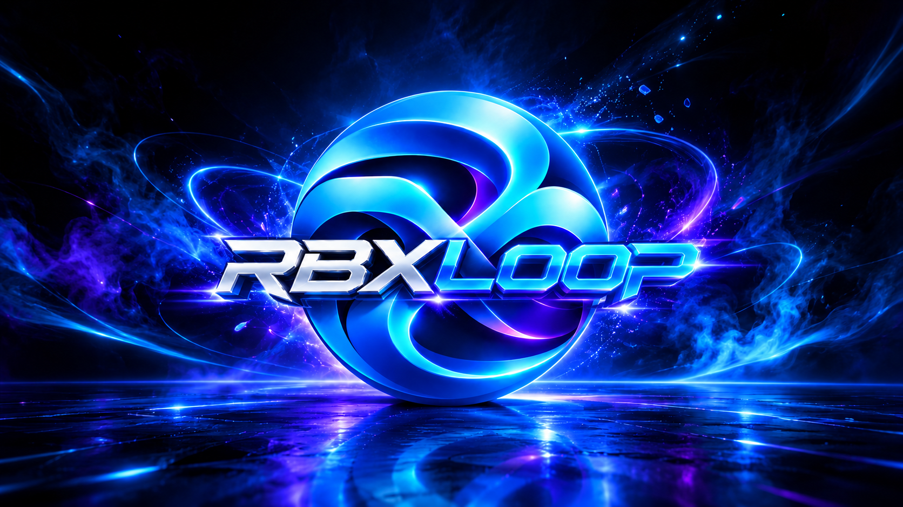

 

  

<h1 align="center">RBXLOOP</h1>

  <strong>Android Emulation & High Performance Graphics Platform</strong>

  Windows üzerinde yeni nesil Android emülasyon deneyimi.

  
  
  
  

---

## About RBXLOOP

RBXLOOP is a Windows-based Android emulation project designed around performance, efficiency and low-latency execution.

The project aims to provide an optimized Android x86_64 environment while making efficient use of the host computer's CPU, memory and GPU resources.

RBXLOOP is being developed as a comprehensive emulation platform rather than a basic virtual machine.

## Core Objectives

- High-performance Android emulation
- Optimized CPU and memory utilization
- GPU acceleration and graphics optimization
- Low-latency input processing
- Efficient graphics composition
- Android application compatibility
- Stable virtualization infrastructure

## Technology & Architecture

| Component | Target |
|---|---|
| Host Platform | Windows |
| Guest Architecture | Android x86_64 |
| Graphics | GPU acceleration |
| Performance | Low latency |
| Memory | Optimized resource management |
| Development | Active R&D |

## Project Structure

The project is organized around several core development areas:

- **Core Engine** — Emulation infrastructure
- **Graphics** — Rendering and GPU communication
- **Memory** — Memory management and optimization
- **Input** — Input handling and latency optimization
- **Compatibility** — Android application support
- **System Integration** — Windows host integration

## Development Status

RBXLOOP is currently under active research and development.

Features, architecture and implementation details may change as development progresses.

No public release is announced at this stage.

## Project Information

**Project:** RBXLOOP  
**Developer:** RBX  
**Platform:** Windows  
**Architecture:** Android x86_64  
**Status:** Active Development  
**Source Model:** Proprietary / Closed Source

## Copyright & Ownership

Copyright © RBX. All rights reserved.

RBXLOOP is a proprietary software project.

No license is granted for copying, modifying, distributing or using this project's source code.

Unauthorized reproduction or redistribution is not permitted.

---

  <strong>RBXLOOP</strong>
   
  Next Generation Android Emulation
    
  Engineered for Performance. Built for the Future.

